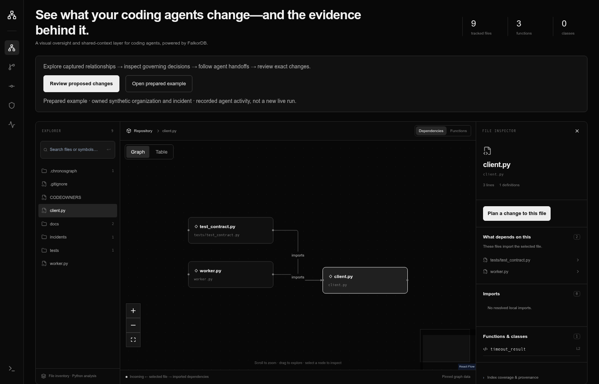

# ChronosGraph

### See what your coding agents change—and the evidence behind it.

A visual oversight and shared-context layer for coding agents, powered by **FalkorDB**.

Explore code relationships, understand project decisions, follow agent handoffs,
and review the exact patch before deciding what happens next.

**[Watch the demo](https://github.com/nakulmaurya/ChronosGraph/releases/download/hackathon-2026-submission/ChronosGraph-interactive-demo.mp4)** · **[Get started](#start-locally)** · **[Documentation](docs/README.md)**

[](https://github.com/nakulmaurya/ChronosGraph/releases/download/hackathon-2026-submission/ChronosGraph-interactive-demo.mp4)

*The 4:34 walkthrough uses a prepared synthetic project with recorded agent activity. The proposed change remains pending human approval.*

## From an agent patch to an informed decision

A patch is only part of the story. What depends on the changed code? Which
requirements apply? What did the reviewer check? What exactly are you approving?

ChronosGraph brings that context into one workspace.

| Capability | What you can do |
| --- | --- |
| **Explore code** | Navigate captured file dependencies, function calls and source excerpts. |
| **Understand requirements** | Inspect governing decisions, incident evidence and declared ownership. |
| **Share context** | Keep task plans and bounded context tied to a saved source revision. |
| **Follow handoffs** | Inspect separate worker and reviewer records without losing the task context. |
| **Review exact changes** | Compare proposed contents with their supporting evidence before a human decision. |

### One connected workflow

**Explore → Understand → Share context → Review → Decide**

Start with a file, follow its captured relationships, inspect the decisions that
apply, and open the task and proposed change. Agent review, test observations,
human approval and execution remain separate.

## Start locally

You need **Python 3.11+**, **Node.js 20.9+**, Git, Bash, npm and Docker.
Windows users can use WSL2 with Docker. [Platform setup](docs/t09-platform-setup.md).

```sh
git clone https://github.com/nakulmaurya/ChronosGraph.git
cd ChronosGraph
bash scripts/start-local.sh
```

Open **http://127.0.0.1:3001**.

The launcher installs dependencies, starts a local FalkorDB instance, loads the
configured examples, and starts the API and frontend. Initial setup requires
network access. Press **Ctrl-C** to stop the processes and container it started.
The default launcher database is ephemeral; use the [persistence guide](docs/task-runtime-hardening-recovery.md)
for retained work. A fresh installation does not recreate recorded agent sessions.

To enable public Python repository imports:

```sh
CHRONOSGRAPH_ENABLE_BROWSER_IMPORT=1 bash scripts/start-local.sh
```

Choose **Import repository** in the application. Importing source does not run it.
For coding-agent integration, follow the [OpenCode setup guide](integrations/opencode/README.md).

## Why FalkorDB

The graph connects code, requirements and change evidence—not just the diagram.
FalkorDB queries retrieve dependencies, governing decisions, task context and
proposal bindings. FastAPI and the MCP tools use the same selected source graph;
the Next.js interface makes those relationships inspectable.

**Stack:** Next.js · TypeScript · React Flow · FastAPI · Python · FalkorDB · MCP

## Graph model and actual queries

Code relationships use `File`, `Function`, `IMPORTS`, `DEFINES` and `CALLS`.
Decisions govern files; task plans, context packs and agent runs retain the
connections behind a proposal.

See the [graph model and query guide](docs/graph-model.md),
[canonical Cypher queries](backend/app/db/queries.py), and [architecture](docs/architecture.md).

## Demos and documentation

- [Product walkthrough](docs/release-demo.md) — recorded UI navigation, task context and proposal review.
- [Real-bug case study](docs/context-integrity-regression.md) — a stale-context defect, its fix and controlled before/after verification.
- [Documentation](docs/README.md) — setup, integrations and technical guides.
- [Current release](docs/current-release.md) — application version and scoped verification.

<details>
<summary>Hackathon tracks</summary>

One workflow connects all three FalkorDB hackathon tracks:

- **Agents That Act on Connected Data:** dependency and governing-decision context for coding investigations.
- **Agent Memory and Coordination:** persistent task context and serialized worker/reviewer handoffs.
- **Company Brain:** engineering knowledge connecting code, ownership, decisions and incidents.

</details>

## Scope

Analysis is Python-focused, static and bounded. Agent acceptance is not human
approval, and incomplete telemetry is not proof of completion. The current setup
is intended for trusted local operation, not hostile-code isolation or a public
multi-user service. [Limitations and evaluation](docs/limitations-and-evaluation.md).

## License

[MIT](LICENSE). See [third-party notices](THIRD_PARTY_NOTICES.md).

<details>
<summary>Credits</summary>

AI tools assisted development, testing, documentation and review. Demo narration
uses a Kokoro stock voice. [Project notes](docs/project-notes.md).

</details>
